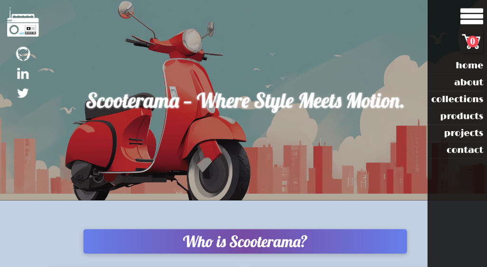
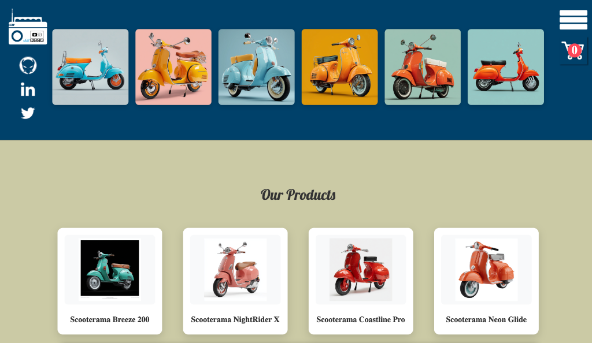
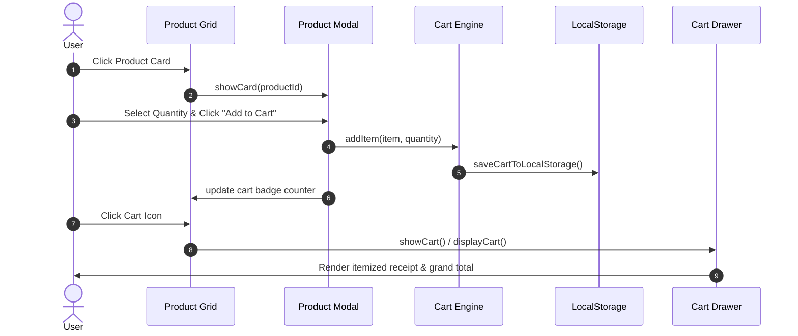

# 🛴 Scooterama — Electric Urban Mobility E-Commerce Platform

[](https://developer.mozilla.org/en-US/docs/Web/JavaScript)
[](https://developer.mozilla.org/en-US/docs/Web/HTML)
[](https://developer.mozilla.org/en-US/docs/Web/CSS)
[](#localstorage-persistence)
[](#responsive-web-design)
[](LICENSE)

A modern, responsive e-commerce web platform for high-performance urban electric scooters. Showcases Object-Oriented JavaScript, interactive sliding drawers, custom animated modal product cards, real-time cart computations, and persistent browser storage.

---

## 📸 Visual Guide & Interface Walkthrough

### 1. Hero Landing & Off-Canvas Navigation Menu
The landing view features a bold California-inspired aesthetic with fixed branding, social links, floating real-time cart counter, and an off-canvas slide-out drawer menu.

<div align="center">
  
</div>

- **Off-Canvas Navigation Drawer**: Triggered via the hamburger icon with smooth jQuery slide animations (`right: 0` $\leftrightarrow$ `right: -226px`).
- **Floating Cart Badge**: Displays real-time aggregate item count with instant visual feedback.
- **Fixed Social & Brand Header**: Seamless fixed positioning providing immediate accessibility across all sections.

---

### 2. Lookbook Collections & Dynamic Product Grid
A visual showcase featuring curated scooter model records and a dynamically rendered e-commerce product catalog.

<div align="center">
  
</div>

- **Curated Collections**: 6-item responsive visual gallery showcasing vintage and modern electric scooter variants.
- **Dynamic Product Cards**: Programmatically rendered from the `scooterProducts` data source via JavaScript DOM injection.
- **Interactive Modal Triggers**: Clicking any product card opens the animated product overlay modal (`#productCard`) with specifications, dynamic imagery, and quantity controls.

---

## 🧠 Technical Highlights & JavaScript Architecture

| Feature | Technical Architecture |
| :--- | :--- |
| **Object-Oriented Programming (OOP)** | `Cart` and `Item` domain classes handle item models, line-item deduplication, quantity increments, and total calculations |
| **LocalStorage Serialization** | Delimiter serialization (`0;0;1;`) loaded on `$(document).ready` for instant session recovery across browser restarts |
| **Dynamic DOM Templating** | Dynamic product card generation, event attachment, and modal population |
| **Animated Transitions** | Fluid UI animations using jQuery animation easing for off-canvas nav, top modal, and bottom cart drawer |
| **Defensive Input Handling** | Ternary validation `quantity = (quantity >= 1) ? quantity : 1` prevents invalid cart quantities |

---

## 🏗️ State & Component Flow



---

## 📱 Responsive Web Design

Designed with a mobile-first philosophy using modern CSS Grid and Flexbox:
- **CSS Grid 12-Column Layout**: Structured layout areas (`hdr`, `abt`, `col`, `prd`, `prj`, `con`, `ftr`).
- **Breakpoints**:
  - **Desktop ($> 1024\text{px}$)**: Full 4-column product grid, 6-column photo collection, 3-column project showcase.
  - **Tablet ($768\text{px} - 1024\text{px}$)**: 2-column product grid, 3-column photo grid, scaled modal drawer.
  - **Mobile ($\le 768\text{px}$)**: Single-column stacked grid, fluid 100% width modals, touch-friendly tap targets, and drawer navigation.
- **Typography**: Custom stylized typography with [Lobster](https://fonts.google.com/specimen/Lobster) and [Limelight](https://fonts.google.com/specimen/Limelight).

---

## 📂 Project Structure

```text
scooterama-ecommerce/
├── assets/
│   ├── images/          # Scooter catalog images, icons, and branding assets
│   └── screenshots/     # UI walkthrough captures and interface showcases
│       ├── 01-hero-and-navigation.png
│       └── 02-collections-and-products-grid.png
├── css/
│   └── app.css          # CSS Grid system, modal overlays, drawer styles, responsive rules
├── js/
│   ├── Item.js          # Item entity definition
│   ├── Cart.js          # Cart class, total calculations, and drawer renderer
│   ├── app.js           # Main event controller, animation triggers, and LocalStorage sync
│   └── jquery.js        # DOM helper and animation utilities
├── index.html           # Main application entry point
├── LICENSE              # MIT License
├── .gitignore           # Git ignore rules
└── README.md            # Project documentation & visual guide
```

---

## 🚀 Getting Started

### Local Setup
1. Clone the repository:
   ```bash
   git clone https://github.com/your-username/scooterama-ecommerce.git
   cd scooterama-ecommerce
   ```
2. Open `index.html` in your web browser:
   ```bash
   # On macOS:
   open index.html

   # On Linux:
   xdg-open index.html

   # On Windows:
   start index.html
   ```

---

## 🛠️ Built With

- **HTML5**: Semantic layout and accessibility
- **CSS3**: CSS Grid Areas, Flexbox, Custom Drop Shadows, Responsive Breakpoints
- **JavaScript (ES6+)**: OOP, LocalStorage API, Dynamic Element Creation
- **jQuery**: Smooth animation transitions for modals and sliding drawers
- **Google Fonts**: [Lobster](https://fonts.google.com/specimen/Lobster) & [Limelight](https://fonts.google.com/specimen/Limelight)

---

## 📄 License

This project is open-source and released under the [MIT License](LICENSE).
